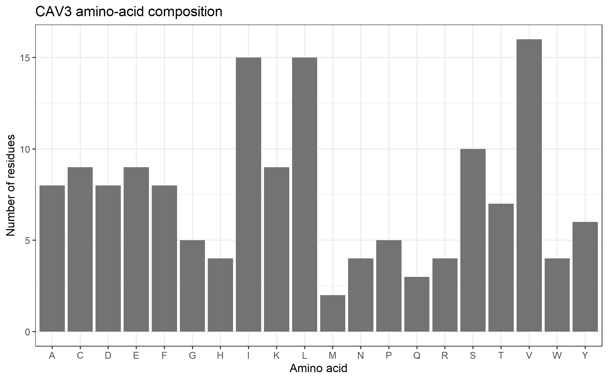
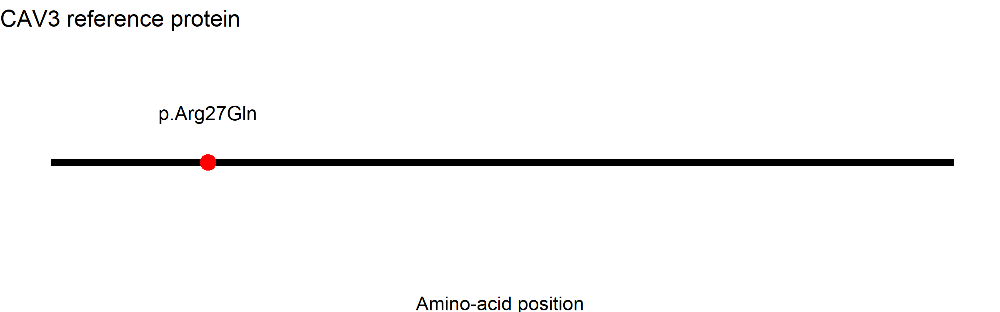

# Molecular Mechanisms of Muscle Contractility
## Protein Structure and Mutation Analysis: CAV3 (Caveolin-3)

**Behante, Fretz Ivan M.** 

**Cell and Molecular Biology**

**Assigned No.:** 45
**Gene:** CAV3  
**Official Gene Name:** Caveolin 3  
**NCBI Gene ID:** 859  
**Organism:** Homo sapiens  
**Assigned Transcript:** NM_033337.3  
**Protein Accession:** NP_203123.1  
**ClinVar Variation ID:** 8283  
**Assigned Variant:** c.80G>A (p.Arg27Gln)  
**Variant Type:** Missense  

---

## Introduction and Research Question

The CAV3 gene encodes caveolin-3, a muscle-specific membrane protein that plays an important role in maintaining the organization and stability of muscle cell membranes. Caveolin-3 is a major component of caveolae, which are small, flask-shaped invaginations of the plasma membrane. These structures are abundant in the sarcolemma, the plasma membrane of muscle cells.

Caveolae help organize membrane proteins and signaling molecules. They also contribute to the ability of muscle cell membranes to respond to mechanical stress during contraction and relaxation. Therefore, changes in caveolin-3 may affect muscle membrane organization and integrity.

This activity focuses on the assigned missense variant p.Arg27Gln, which replaces arginine with glutamine at amino-acid position 27.

**Research Question:**

How might the CAV3 missense variant c.80G>A (p.Arg27Gln) affect caveolin-3 protein function and contribute to changes in muscle cell membrane organization and integrity?

---

## Methods and Analysis Workflow

The analysis was performed using RStudio, the `rentrez` package, and `ggplot2`. NCBI databases were used to retrieve the assigned gene and its corresponding protein sequence.

### Step 1. R Project Setup

A project named `Muscle_Contractility_CAV3` was created in RStudio. The following folders and files were prepared:

- `data/` – stores the retrieved protein FASTA sequence.
- `results/` – stores gene information, protein accession, and amino-acid composition.
- `figures/` – stores the generated visualizations.
- `analysis.R` – contains the R commands used in the analysis.

The required packages were installed and loaded:

```r
install.packages(c("rentrez", "ggplot2"))

library(rentrez)
library(ggplot2)
```

### Step 2. Retrieval of the NCBI Gene Record

The assigned human gene was searched using its exact gene symbol and human taxonomy ID through the `rentrez` package.

The retrieved gene information was checked and saved in:

`results/gene_summary.txt`

The following information was recorded:

- Gene symbol: CAV3
- NCBI Gene ID: 859
- Official name: caveolin 3
- Chromosome: 3

### Step 3. Retrieval of the Matching Protein Sequence

The assigned transcript, `NM_033337.3`, was retrieved from the NCBI Nucleotide database. Its GenBank record was examined to identify the corresponding RefSeq protein accession.

The matching protein sequence was retrieved in FASTA format and saved as:

`data/CAV3_protein.fasta`

The protein accession was recorded in:

`results/protein_accession.txt`

**Retrieved protein accession:** NP_203123.1

### Step 4. Protein Length and Amino-Acid Composition Analysis

The FASTA sequence was read in R, and the number of amino-acid residues was calculated. The frequency of each of the 20 standard amino acids was also determined.

The results were saved as:

`results/amino_acid_composition.csv`

An amino-acid composition bar plot was generated using `ggplot2` and saved as:

`figures/01_amino_acid_composition.png`

The three most abundant amino acids were identified by arranging the amino-acid counts from highest to lowest.

### Step 5. ClinVar Variant Analysis

The assigned variant was examined using its fixed ClinVar Variation ID.

ClinVar record:  
https://www.ncbi.nlm.nih.gov/clinvar/variation/8283/

The following information was recorded:

- Variant: c.80G>A
- Protein change: p.Arg27Gln
- Variant type: Missense
- Aggregate classification: Pathogenic
- Supporting submissions: 15 of 19 submitted records contributed to the aggregate classification.

The amino-acid substitution and the available clinical, computational, and experimental evidence were examined. The classification was interpreted based on the ClinVar record accessed on November 7, 2026.

### Step 6. Protein Variant Visualization

Because the assigned variant is a missense mutation with a defined protein-level consequence, Option A from the laboratory instructions was selected.

A linear protein map was used to show the complete reference protein length and the position of the affected amino acid.

The figure marks residue 27 in the 151-amino-acid Caveolin-3 protein.

The generated figure was saved as:

`figures/02_variant_position.png`

This visualization identifies the location of the amino-acid substitution but does not independently demonstrate a structural or functional change.

### Step 7. Molecular Mechanism Analysis

The normal function of caveolin-3 was examined using protein and scientific literature resources. The assigned amino-acid substitution was then evaluated in relation to the protein's membrane-associated functions.

A possible relationship between the mutation, caveolin-3 localization, caveolae organization, and muscle membrane integrity was developed. Experimental findings, clinical observations, and predicted effects were considered separately.

A possible validation experiment using immunofluorescence microscopy was also proposed to examine the localization of normal and mutant caveolin-3 in muscle cells.

---

## Results

### NCBI Gene and Protein Retrieval

| Parameter | Retrieved Information |
|---|---|
| Gene symbol | CAV3 |
| Official gene name | caveolin 3 |
| NCBI Gene ID | 859 |
| Chromosome | 3 |
| Transcript accession | NM_033337.3 |
| Protein accession | NP_203123.1 |
| Protein length | 151 amino acids |

The protein sequence retrieved from NCBI corresponds to the assigned CAV3 transcript, NM_033337.3.

### Amino-Acid Composition

The amino-acid composition analysis identified the frequency of all 20 standard amino acids in the 151-amino-acid Caveolin-3 protein.

| Amino Acid | Count |
|---|---:|
| Alanine (A) | 8 |
| Cysteine (C) | 9 |
| Aspartic acid (D) | 8 |
| Glutamic acid (E) | 9 |
| Phenylalanine (F) | 8 |
| Glycine (G) | 5 |
| Histidine (H) | 4 |
| Isoleucine (I) | 15 |
| Lysine (K) | 9 |
| Leucine (L) | 15 |
| Methionine (M) | 2 |
| Asparagine (N) | 4 |
| Proline (P) | 5 |
| Glutamine (Q) | 3 |
| Arginine (R) | 4 |
| Serine (S) | 10 |
| Threonine (T) | 7 |
| Valine (V) | 16 |
| Tryptophan (W) | 4 |
| Tyrosine (Y) | 6 |

The three most abundant amino acids were:

1. Valine (V) – 16 residues
2. Isoleucine (I) – 15 residues
3. Leucine (L) – 15 residues

These three amino acids are hydrophobic, meaning that their side chains tend to avoid water. Their abundance is consistent with the membrane-associated nature of caveolin-3. However, amino-acid frequency alone cannot establish the exact protein structure, biological function, or effect of a particular mutation.

**Figure 1. Amino-Acid Composition of Caveolin-3**



### ClinVar Variant Information

The assigned variant is CAV3 c.80G>A (p.Arg27Gln), recorded under ClinVar Variation ID 8283.

The nucleotide substitution changes the codon so that arginine (Arg or R) is replaced by glutamine (Gln or Q) at amino-acid position 27. This is classified as a missense variant because it changes one amino acid in the protein sequence.

The ClinVar aggregate classification recorded during this activity was **Pathogenic**, with 15 of 19 submitted records contributing to the aggregate classification.

The supporting evidence described in the ClinVar record includes clinical observations, reported segregation with disease, a de novo observation, computational predictions, and experimental studies showing an effect on CAV3 function.

Some earlier reports use the alternative designation R26Q for this variant. The assigned transcript and protein notation used in this activity are NM_033337.3:c.80G>A and p.Arg27Gln.

ClinVar record: https://www.ncbi.nlm.nih.gov/clinvar/variation/8283/

### Variant Position in the Reference Protein

The assigned substitution affects amino-acid residue 27 of the 151-amino-acid Caveolin-3 protein.

**Figure 2. Position of the p.Arg27Gln Variant in Caveolin-3**



The marker indicates the position of the assigned amino-acid substitution in the reference protein. It represents the location of the variant and does not directly show the three-dimensional structural consequences of the mutation.

---

## Guided Questions

### 1. What does your assigned gene encode, and how does this protein contribute to muscle function?

The CAV3 gene encodes caveolin-3, a muscle-specific membrane protein found mainly in the sarcolemma and T-tubule system of muscle cells. It is an important component of caveolae, which are small membrane structures that help organize proteins involved in cellular signaling. Caveolae also contribute to membrane stability and help muscle cells respond to mechanical stress during contraction and relaxation. Therefore, caveolin-3 supports muscle function by maintaining proper membrane organization and integrity rather than directly producing muscle contraction.

### 2. What was the exact protein accession and length retrieved with R?

The protein accession retrieved from the assigned transcript NM_033337.3 was **NP_203123.1**. The FASTA sequence contained **151 amino acids**. This accession represents the matching RefSeq protein sequence used for the amino-acid composition analysis and variant-position visualization.

### 3. What did the amino-acid composition chart show? What can it NOT tell you?

The amino-acid composition chart showed that valine was the most abundant amino acid, with 16 residues, followed by isoleucine and leucine, with 15 residues each. These amino acids are hydrophobic and are commonly associated with regions of proteins that interact with lipid membranes. However, the chart cannot independently determine the exact three-dimensional structure, protein localization, biological activity, or the functional effect of the p.Arg27Gln mutation. It only describes the frequency of amino acids in the retrieved reference sequence.

### 4. What is your fixed ClinVar variant, and what is its current classification and evidence strength?

The assigned variant is **CAV3 NM_033337.3:c.80G>A (p.Arg27Gln)**, recorded under ClinVar Variation ID **8283**. The ClinVar aggregate classification recorded during this activity was **Pathogenic**, with 15 of 19 submitted records contributing to the classification. The evidence includes reported clinical observations, segregation and de novo findings, computational predictions, and published experimental studies demonstrating an effect on CAV3 function. These different types of evidence support the classification, although they do not all provide the same level or type of evidence. The exact review status and classification should be interpreted from the ClinVar record at the time of access.

### 5. What is the scientifically supported mechanism linking this variant to muscle function, and what remains uncertain?

Caveolin-3 contributes to caveolae formation and organization in the muscle cell membrane. Published studies associated with p.Arg27Gln have reported reduced caveolin-3 expression at the sarcolemma and abnormal protein localization, supporting an effect on protein stability or membrane delivery. A reduction or dysfunction of caveolin-3 may disturb caveolae organization and affect the membrane's ability to withstand mechanical stress. However, the exact sequence of molecular events leading from this specific amino-acid substitution to the different muscle symptoms is not completely established. The variant should therefore not be described as directly disrupting the actin–myosin contraction cycle without additional evidence.

### 6. What additional experiment would help test the proposed mechanism?

Immunofluorescence microscopy using cultured C2C12 muscle cells could help test the proposed mechanism. Cells expressing normal caveolin-3 and cells expressing the p.Arg27Gln variant could be compared using a Caveolin-3-specific antibody. The fluorescence distribution and intensity at the cell membrane could then be examined to determine whether the mutant protein shows reduced membrane localization or increased intracellular accumulation. This experiment would help evaluate whether the variant affects caveolin-3 localization. Additional membrane-stress or membrane-repair assays could be performed to investigate its possible effects on muscle membrane integrity.

---

## Discussion

Caveolin-3 is an important membrane-associated protein in skeletal and cardiac muscle. It is a major component of caveolae, which are small invaginations of the plasma membrane that help organize signaling molecules and contribute to membrane protection. During repeated muscle contraction and relaxation, the sarcolemma experiences mechanical stress. Caveolae help the membrane respond to these changes, making caveolin-3 important for maintaining normal muscle cell membrane organization and integrity.

The protein sequence analysis retrieved NP_203123.1, which contains 151 amino acids. The amino-acid composition showed that valine, isoleucine, and leucine were the most abundant residues. These are hydrophobic amino acids, which are compatible with the membrane-associated nature of caveolin-3. However, this result describes only the composition of the reference sequence. It does not directly establish the protein's three-dimensional structure or explain how the assigned mutation changes its function.

The assigned variant, c.80G>A (p.Arg27Gln), replaces arginine with glutamine at residue 27. ClinVar classifies this variant as pathogenic. Its supporting evidence includes clinical observations in individuals with CAV3-associated muscle conditions, reported segregation with disease, a de novo observation, computational predictions, and published functional studies. Experimental reports have described reduced caveolin-3 expression at the muscle membrane and abnormal protein localization. These findings support the possibility that the substitution affects protein stability or its delivery to the sarcolemma.

A possible molecular consequence is that reduced or improperly localized caveolin-3 could interfere with normal caveolae organization. This may weaken the membrane's ability to respond to mechanical stress and contribute to muscle cell damage or abnormal muscle function. However, the exact molecular steps connecting p.Arg27Gln to each reported clinical manifestation remain uncertain. Clinical findings also vary among individuals carrying this variant, so one specific symptom should not be expected in every carrier.

To further investigate the proposed mechanism, immunofluorescence microscopy could be performed using normal and p.Arg27Gln caveolin-3 in cultured muscle cells. Comparing membrane localization and intracellular accumulation would help determine whether the variant affects protein distribution. Additional membrane-stress experiments would be needed to directly examine its effects on membrane stability.

Overall, the findings support the importance of caveolin-3 in muscle membrane organization and show that p.Arg27Gln has clinical and experimental evidence of functional significance. Nevertheless, further experiments are needed to establish the complete molecular mechanism linking this variant to muscle dysfunction.

---

## Limitations and Proposed Validation

Several limitations should be considered when interpreting the results.

First, amino-acid composition analysis only provides the frequency of residues in the reference protein. It cannot independently predict protein folding, membrane localization, or the effect of a mutation.

Second, the linear variant-position plot identifies the location of residue 27 but does not show the actual structural changes caused by the substitution.

Third, ClinVar classifications and submitted evidence may be updated over time. Clinical observations, computational predictions, and experimental findings should be interpreted as different forms of evidence rather than treated as interchangeable.

Finally, although published studies report functional effects associated with p.Arg27Gln, the complete molecular mechanism connecting this specific substitution to muscle dysfunction remains incompletely understood.

A useful validation experiment would be immunofluorescence microscopy comparing normal and mutant caveolin-3 in cultured muscle cells. This would help determine whether the p.Arg27Gln substitution affects the localization of caveolin-3 at the sarcolemma. Additional membrane-repair or mechanical-stress assays could provide further evidence about its effects on muscle membrane integrity.

---

## Conclusion

This activity successfully retrieved and analyzed the assigned CAV3 gene and its corresponding reference protein sequence. The analysis identified a 151-amino-acid Caveolin-3 protein and determined its amino-acid composition. The assigned p.Arg27Gln variant was identified as a missense substitution classified as pathogenic in ClinVar.

The available clinical and experimental evidence supports an effect of this variant on caveolin-3 function, particularly its expression and localization at the muscle cell membrane. Since caveolin-3 contributes to caveolae organization and membrane integrity, changes in its function may affect the ability of muscle cells to respond to mechanical stress. Further experiments are still needed to clarify the exact molecular mechanism.

---

## References and Database Links

### Database Resources

1. NCBI Gene. CAV3 – Caveolin 3, Gene ID: 859.  
   https://www.ncbi.nlm.nih.gov/gene/859

2. NCBI Nucleotide. RefSeq transcript NM_033337.3.  
   https://www.ncbi.nlm.nih.gov/nuccore/NM_033337.3

3. NCBI Protein. RefSeq protein NP_203123.1.  
   https://www.ncbi.nlm.nih.gov/protein/NP_203123.1

4. NCBI ClinVar. CAV3 Variation ID: 8283.  
   https://www.ncbi.nlm.nih.gov/clinvar/variation/8283/

5. UniProt. Caveolin-3 (P56539).  
   https://www.uniprot.org/uniprotkb/P56539/entry

6. AlphaFold Protein Structure Database. Caveolin-3 (P56539).  
   https://alphafold.ebi.ac.uk/entry/P56539

7. rentrez R Package Documentation.  
   https://docs.ropensci.org/rentrez/

### Scientific References

1. Gazzerro, E., Bonetto, A., & Minetti, C. (2010). Caveolinopathies: From the biology of caveolin-3 to human diseases. *European Journal of Human Genetics, 18*, 137–145.  
   https://doi.org/10.1038/ejhg.2009.103

2. Carbone, I., et al. (2000). Mutation in the CAV3 gene causes partial caveolin-3 deficiency and hyperCKemia. *Neurology*.  
   https://pubmed.ncbi.nlm.nih.gov/10746614/

3. Lamaze, C., Blouin, C. M., & Sens, P. (2026). Caveolae mechanics in cellular functions and disease. *Nature Reviews Molecular Cell Biology, 27*, 581–600.  
   https://doi.org/10.1038/s41580-026-00964-2

4. NCBI ClinVar. Variation ID 8283 – CAV3 p.Arg27Gln.  
   https://www.ncbi.nlm.nih.gov/clinvar/variation/8283/

**Database access date:** November 7, 2026.
